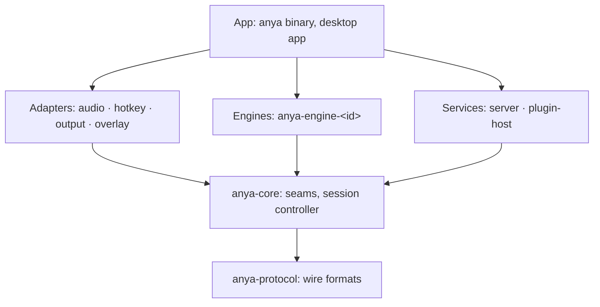

# Architecture

Anya turns speech into text and hands it to whatever wants it. A small core captures audio, runs a session through an engine and publishes frames. What decides *when* to listen (triggers) and *what to do* with the text (sinks) sits around it. Pasting into the focused field is one sink among others, reading the same frames an outside app reads.

## Layers

An arrow is an allowed dependency (the app may also use core and protocol directly). A crate depends only on layers below it, never on a sibling: the hotkey adapter does not call the output adapter; both meet in core and the app wires them. `xtask/src/arch.rs` is this rule as code, and `cargo test` runs it on the workspace. It also holds:

- `anya-protocol` uses `serde` only; `anya-core` uses `serde`, `thiserror`, `tokio` only. Heavier dependencies belong in an adapter or a service.
- Platform bindings (cpal, evdev, x11rb, Wayland, objc2, core-graphics, Tauri…) and `allow(unsafe_code)` appear only in adapters and the app.
- Only an engine's own crate and the app name an engine id. Core, services and UIs read engines through their `Manifest`.
- No Windows crates (docs/decisions/0001).

## Crates

| Path | Package | Layer | Owns | State |
|---|---|---|---|---|
| `crates/protocol` | `anya-protocol` | protocol | subscriber `Frame`s, `Recognition`, engine `Manifest`, `PROTOCOL_VERSION`, the ordering checker, fixtures | types, JSON pinned, fixtures checked |
| `crates/core` | `anya-core` | core | `AudioSource` and `Engine` seams; the session controller | seams; controller next |
| `crates/audio` | `anya-audio` | adapter | capture: cpal; ScreenCaptureKit for system audio on macOS | planned |
| `crates/hotkey` | `anya-hotkey` | adapter | evdev (Wayland), x11rb (X11), CGEventTap (macOS) | planned |
| `crates/output` | `anya-output` | adapter | paste and clipboard sinks | planned |
| `crates/overlay` | `anya-overlay` | adapter | recording overlay: layer-shell, X11, NSPanel with the notch | planned |
| `crates/engines/<id>` | `anya-engine-<id>` | engine | one engine each; built in: doubao, dashscope, an OpenAI-compatible one | planned |
| `crates/server` | `anya-server` | service | WebSocket subscription, control API, auth | planned |
| `crates/plugin-host` | `anya-plugin-host` | service | the Bun process, plugin install, `plugins.json`, the plugin engine adapter | planned |
| `crates/anya` | `anya` | app | the `anya` binary: daemon, `subscribe`, `replay`, `plugin` | planned |
| `app/` | `anya-app` | app | Tauri v2 tray and settings window | planned |
| `host/` | — | — | `host.js`, the Bun side of the plugin host, embedded in the binary | planned |
| `sdk/plugin/` | `@anyahq/plugin` | — | what plugin authors build on | planned |
| `sdk/client/` | `@anyahq/client` | — | a thin subscriber for apps, tested against the fixtures | planned |
| `xtask` | `xtask` | tooling | `cargo xtask check`, `cargo xtask ci` | in place |

A crate directory appears with its first code. Its layer is already in `Layer::of`, so the rules apply from its first commit.

## Session flow

1. A trigger asks core for a session of a source (`dictation`, `continuous`): the hotkey adapter on a key press, the continuous switch, later an app through the control API.
2. Core opens the source's device through `AudioSource` and the chosen engine through `Engine::open`, and pumps `Chunk`s into the session.
3. Core turns the engine's `Output`s into frames: `session_start` on `Ready`, `result` per `Recognition`, `session_end` with a reason.
4. Sinks read frames. Output pastes a dictation session's final text once; the overlay shows partials; the server forwards to each subscriber the sources it was granted.

Ending is asked for, not done in place: the trigger sends `Finish`, core waits for the engine's final result, and stopping capture and dispatching happen on a task.

## Seams

| Seam | Defined in | Adapters |
|---|---|---|
| `Engine` | `anya_core::engine` | built-in engine crates; the plugin host's adapter for Bun engines |
| `AudioSource` | `anya_core::audio` | platform capture in `anya-audio`; a file-replaying fake for tests |
| frames | `anya-protocol` | every sink, in process and over the WebSocket |

Triggers and sinks get a trait once two adapters need the same one. Until then they are roles: a trigger calls the session controller, a sink reads frames.

## Threads and blocking

- A hotkey callback runs on the OS event thread (CGEventTap, the evdev reader). It records the edge and returns. A blocked event tap stalls every keystroke on the machine.
- Tokio is the only async runtime. Callbacks bound to a thread (AppKit's main thread, cpal's audio thread) hand off through channels.
- Publishing never waits on a subscriber: each has a bounded buffer, and one that falls behind is dropped.

## Plugins

Built-in pieces are crates in the binary that the user switches on or off. Community plugins run out of process in one Bun host and talk to Anya in JSON lines over stdin/stdout (docs/decisions/0004). An engine plugin sends a `Manifest` and `Recognition`s, the shapes built-in engines use, so the plugin host's engine adapter is one more `Engine`.

## Downstream apps

Programs that subscribe to frames are the other half of the community (docs/decisions/0007). What they may rely on is [docs/protocol.md](docs/protocol.md): the frames, ten ordering promises, the compatibility rule and the fixtures. `anya_protocol::contract::check` is the promises as code; the fixtures pass it and so must everything that emits frames. Built-in sinks read the same frames, so a built-in feature that needs more than the frames give needs a protocol change first.

## Decisions

`docs/decisions/` keeps one record per decision with its reasons. Changing one means a new record that supersedes it.
