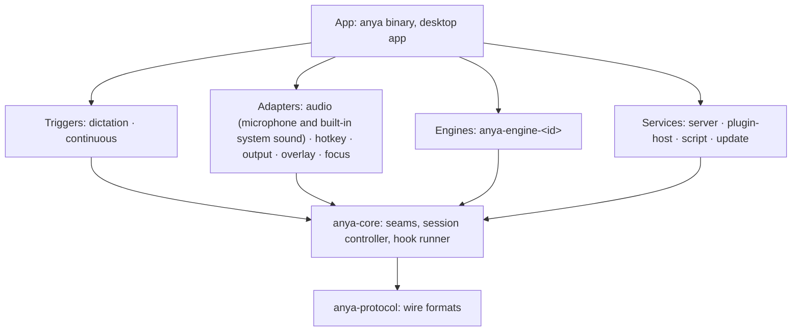

# Architecture

Anya turns speech into text and hands it to whatever wants it. A small core accepts local or authorized remote audio, runs a recognition session through an engine and publishes frames. What decides *when* to listen (triggers) and *what to do* with the text (sinks) sits around it. Pasting into the focused field is one sink among others, and a remote client can receive the same session results through the ASR gateway. Around a local dictation, plugins add context before the engine opens, transform the final text and act on it beside the paste (docs/decisions/0016).

## Layers

An arrow is an allowed dependency (the app may also use core and protocol directly). A crate depends only on layers below it, never on a sibling: the hotkey adapter does not call the output adapter; both meet in core and the app wires them. `xtask/src/arch.rs` is this rule as code, and `cargo test` runs it on the workspace. It also holds:

- `anya-protocol` uses `serde` only; `anya-core` and the triggers use `serde`, `thiserror`, `tokio`, `tracing` only. Heavier dependencies belong in an adapter or a service.
- Platform bindings (cpal, evdev, x11rb, Wayland, objc2, core-graphics, Tauri…) and `allow(unsafe_code)` appear only in adapters and the app.
- Only an engine's own crate and the app name an engine id. Core, services and UIs read engines through their `Manifest`.
- No Windows crates (docs/decisions/0001).

## Crates

| Path | Package | Layer | Owns | State |
|---|---|---|---|---|
| `crates/protocol` | `anya-protocol` | protocol | subscriber `Frame`s, `Recognition`, engine `Manifest`, `PROTOCOL_VERSION`, the ordering checker, fixtures | types, JSON pinned, fixtures checked |
| `crates/core` | `anya-core` | core | `AudioSource` and `Engine` seams, the session `Hub`, `Desktop` detection; the `ContextHook`, `TransformHook` and `ActionHook` seams and their runner: budgets, the transform chain, per-plugin action queues, `ContextEngine` | in place |
| `crates/plugin-rt` | `anya-plugin-rt` | core | the plugin runtime: `Plugin`, `Point`, `Runtime::reconcile`, `compose`; it names no seam of Anya's (docs/decisions/0012) | in place |
| `crates/dictation` | `anya-dictation` | trigger | toggle and hold, stop delay, cancel and retry, dispatching final text once | in place |
| `crates/continuous` | `anya-continuous` | trigger | one device kept open, the silence gate, reconnecting | in place |
| `crates/audio` | `anya-audio` | adapter | capture: cpal; CoreAudio process tap on macOS and the PulseAudio/PipeWire monitor on Linux | in place |
| `crates/hotkey` | `anya-hotkey` | adapter | evdev (Wayland), x11rb (X11), CGEventTap (macOS) | in place |
| `crates/output` | `anya-output` | adapter | paste and clipboard sinks | in place |
| `crates/overlay` | `anya-overlay` | adapter | recording overlay: layer-shell, X11, NSPanel with the notch | in place |
| `crates/focus` | `anya-focus` | adapter | which app has the keyboard focus, for context hooks: the frontmost bundle id on macOS, the active window's class on X11, none on Wayland | in place |
| `crates/engines/<id>` | `anya-engine-<id>` | engine | one engine each; built in: doubao, dashscope, openai, auralwise, mimo | in place |
| `crates/server` | `anya-server` | service | WebSocket subscription, authenticated remote dictation, pairing and paired clients, the TLS LAN listener; each server's `Audience`: who opened a session and how many subscribers were sent it | in place |
| `crates/plugin-host` | `anya-plugin-host` | service | host plugins, one Bun process each with a watchdog, restarted with backoff; their engines as `Engine`s and their hooks as hook adapters; the anya-plugins index, installs checked against their sha512 integrity, `plugins.json`; finding or downloading a pinned Bun | in place |
| `crates/script` | `anya-script` | service | inline plugins: each a QuickJS runtime on a thread of its own with no I/O, every call within a time and memory budget; their hooks as hook adapters | in place |
| `crates/update` | `anya-update` | service | whether the Homebrew tap's formula names a newer version, whether this install is under a Cellar, and running `brew upgrade anya` (docs/decisions/0014) | in place |
| `crates/config` | `anya-config` | app | the config file: shape, defaults, validation, atomic save | in place |
| `crates/i18n` | `anya-i18n` | app | every user-facing string, locale detection (docs/decisions/0008) | in place |
| `crates/runtime` | `anya-runtime` | app | `Control`, what the UIs may ask of a running Anya, and its data | in place |
| `crates/tui` | `anya-tui` | app | the terminal UI | in place |
| `crates/gui` | `anya-gui` | app | the settings page, the desktop window and tray (tao, wry, tray-icon), `--web` | in place |
| `crates/anya` | `anya` | app | the `anya` binary: daemon, `subscribe`, `replay`, `plugin`; the route page's view of the hub (`route.rs`), in memory only | in place |
| `host/` | — | — | `host.js`, the Bun side of a host plugin's process, embedded in the binary | in place |
| `sdk/plugin/` | `@wakaka6/anya-plugin` | - | what plugin authors build on (docs/plugins.md) | in place |
| `plugins/` | - | - | the official plugins, one directory each, built into the `anya` binary (docs/decisions/0017) and tested with `bun test` | in place |
| `sdk/client/` | `@wakaka6/anya-client` | — | a thin subscriber for apps, tested against the fixtures | planned |
| `xtask` | `xtask` | tooling | `cargo xtask check`, `cargo xtask ci` | in place |

A crate directory appears with its first code. Its layer is already in `Layer::of`, so the rules apply from its first commit.

## Session flow

1. A trigger or an authorized remote client asks core for a session of a source (`dictation`, `continuous`). The hotkey adapter starts local dictation; the continuous switch opens system sound; the gateway accepts a client's microphone stream.
2. Core opens the engine chosen for that use (`[recognition] dictation`, `continuous` or `remote`, read at each session open) through `Engine::open` and pumps `Chunk`s into the session. Local capture uses `AudioSource`; remote capture is pushed by the gateway. A batch engine buffers inside its session until `Finish`.
3. Core turns the engine's `Output`s into frames: `session_start` on `Ready`, `result` per `Recognition`, `level` per audio chunk, and `session_end` with a reason. Streaming engines produce partial results; batch engines produce only the final result after stop.
4. Sinks read frames. Local output pastes a local dictation session's final text once; a remote dictation session returns frames to its requesting client; the server forwards granted sources to subscribers.

Ending is asked for, not done in place: the trigger sends `Finish`, core waits for the engine's final result, and stopping capture and dispatching happen on a task.

A local dictation also runs hooks (docs/decisions/0016). Before step 2 the app wraps the chosen engine in `ContextEngine`, which asks the context hooks for hotwords and a language while audio already queues. After the final result the app runs the transform chain on its text, hands the result to every action without waiting for them, and pastes it. Frames still carry the engine's text; what was pasted is the chain's. Continuous and remote sessions run no hooks.

## Seams

| Seam | Defined in | Adapters |
|---|---|---|
| `Engine` | `anya_core::engine` | built-in engine crates; the plugin host's adapter for Bun engines |
| `AudioSource` | `anya_core::audio` | platform capture in `anya-audio`; a file-replaying fake for tests |
| `ContextHook` | `anya_core::hooks` | inline plugins (`anya-script`); host plugins (`anya-plugin-host`) |
| `TransformHook` | `anya_core::hooks` | the built-in replacement list; inline plugins; host plugins |
| `ActionHook` | `anya_core::hooks` | host plugins. Paste is the built-in action (docs/decisions/0016): the app runs it beside them on the chain's text, on by default, and `[dictation] output` switches it to the clipboard or off |
| frames | `anya-protocol` | every sink, in process and over the WebSocket |

Triggers and sinks get a trait once two adapters need the same one. Until then they are roles: a trigger calls the session controller, a sink reads frames.

## Threads and blocking

- A hotkey callback runs on the OS event thread (CGEventTap, the evdev reader). It records the edge and returns. A blocked event tap stalls every keystroke on the machine.
- Tokio is the only async runtime. Callbacks bound to a thread (AppKit's main thread, cpal's audio thread) hand off through channels.
- Publishing never waits on a subscriber: each has a bounded buffer, and one that falls behind is dropped.

## Plugins

Built-in pieces are crates in the binary that the user switches on or off. A community plugin is a package with up to two entries (docs/decisions/0015). Its inline entry runs in QuickJS inside Anya (`anya-script`), with no network or disk and every call stopped at its budget. Its host entry runs in a Bun process of its own that talks to Anya in JSON lines over stdin/stdout; a watchdog pings it every second and kills and restarts it after 3 seconds of silence, so one stuck plugin stalls no other. The `anya-plugins` registry discovers and distributes reviewed packages; a tag or release updates the registry index, while installation and enabling remain explicit user actions (docs/decisions/0010). An engine plugin sends a `Manifest` and `Recognition`s, the shapes built-in engines use, so the plugin host's engine adapter is one more `Engine`; its hooks are one more `ContextHook`, `TransformHook` or `ActionHook`.

Built-in pieces run on `anya-plugin-rt` (docs/decisions/0012): the app lists them, the runtime applies the ones the user has not turned off, and each serves what it provides into a `Point`: `engines`, `contexts`, `transforms` or `actions`. The four are peers (docs/decisions/0016). The plugin host serves its engines into `engines`; the built-in `community-hooks` serves every community plugin's hooks into the other three, so turning it off stops them all, and the built-in `replace` serves the replacement list into `transforms`.

## Downstream apps

Programs that subscribe to frames are the other half of the community (docs/decisions/0007). What they may rely on is [docs/protocol.md](docs/protocol.md): the frames, ten ordering promises, the compatibility rule and the fixtures. `anya_protocol::contract::check` is the promises as code; the fixtures pass it and so must everything that emits frames. Built-in sinks read the same frames, so a built-in feature that needs more than the frames give needs a protocol change first.

## Decisions

`docs/decisions/` keeps one record per decision with its reasons. Changing one means a new record that supersedes it.
