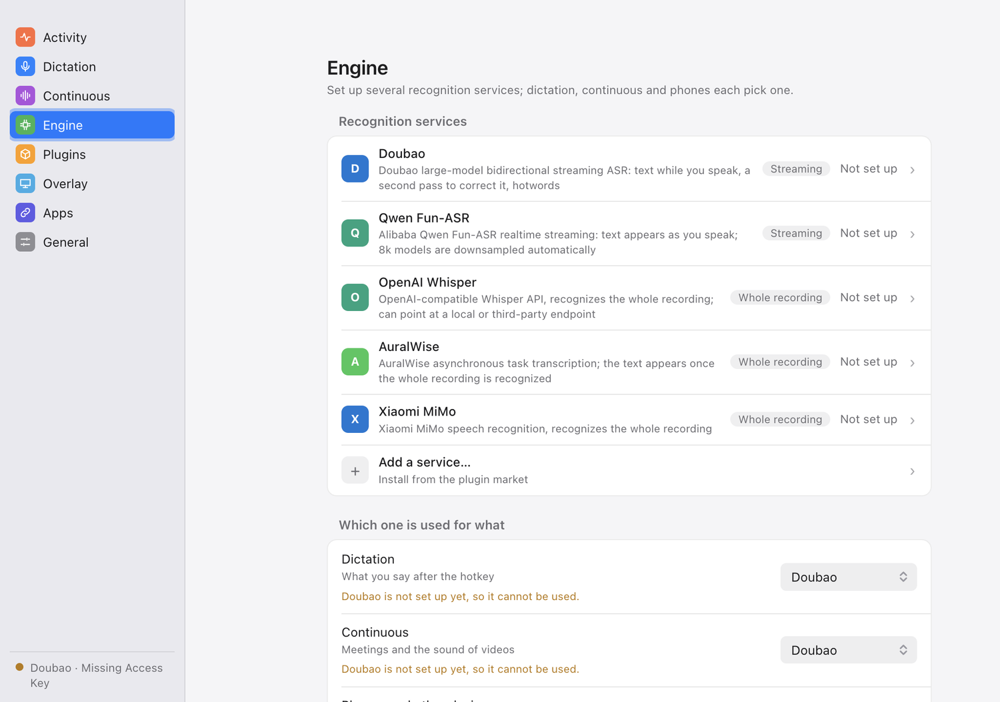
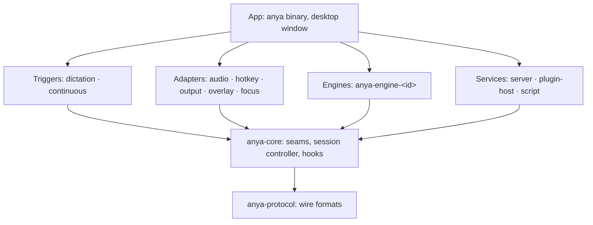

<div align="center">

<picture>
  <source media="(prefers-color-scheme: dark)" srcset="docs/assets/logo-dark.png">
  
</picture>

# Anya

**Hears what you say, and hands it to any program that wants it.**

[](https://github.com/wakaka6/anya/actions/workflows/ci.yml)
[](LICENSE)
[](rust-toolchain.toml)
[](docs/decisions/0001-rust-linux-macos.md)

[中文](README.md) · [Protocol](docs/protocol.md) · [Plugins](docs/plugins.md) · [Architecture](ARCHITECTURE.md) · [Changelog](CHANGELOG.md)

</div>

<p align="center">
  
</p>

Anya is a local speech-to-text service for Linux and macOS. A small core only captures audio and runs recognition; dictation, continuous transcription, pasting, the overlay and speech engines all plug in around it. Other programs subscribe to the same recognition frames the built-in features read.

- **Dictate into any field**: hold or tap a hotkey, speak, and the result is pasted at the cursor or put on the clipboard.
- **Transcribe any sound**: continuous transcription of the microphone or of what the system is playing (a CoreAudio process tap on macOS, the PulseAudio/PipeWire monitor on Linux; no virtual audio driver).
- **Your choice of engine**: Doubao, DashScope, OpenAI-compatible, AuralWise and MiMo are built in; dictation, continuous transcription and LAN apps can each use a different one.
- **Plugins**: community npm packages that add engines, add hotwords before a dictation, rewrite its text before the paste, or send it elsewhere at the same time; checked against an integrity hash before install.
- **An ASR gateway**: a phone, a browser or another computer pairs with Anya and sends its own microphone for recognition, without an engine account of its own.
- **Build on it**: meeting notes, live captions, translation, an agent that listens, all reading the same frames.
- **Private by default**: audio goes only to the engine you chose; if it fails you see the error, and Anya never quietly retries on another one.

## Status

Early, with no release yet. It runs end to end on macOS and Linux (Wayland, X11), but the subscriber protocol is still version 0 and may change; every change is in the [CHANGELOG](CHANGELOG.md).

## Install

For now, build from source. Needs Rust 1.95 (picked by `rust-toolchain.toml`).

```bash
cargo build --release -p anya
target/release/anya --doctor    # check the environment: what is missing and how to fix it
target/release/anya --install   # copy to ~/.local/bin/anya
```

## Use

```bash
anya                  # start: the tray app and settings window
anya --tui            # the terminal UI instead of the desktop window
anya --web            # open the settings page in a browser on 127.0.0.1
anya --daemon         # run without a UI, logging to stderr
anya subscribe        # print the running Anya's frames as NDJSON
anya replay <file>    # serve a recorded frame stream: build apps without a microphone
```

The config file is `~/.config/anya/config.toml`, saved atomically and readable only by you; an edit made outside Anya is picked up by a running Anya. The interface follows the system language, or `[ui] language` (English and Simplified Chinese for now).

### Hotwords

`[recognition] hotwords` holds fixed words, and `hotwords_file` points to another file (one word per line, `#` for comments). It is read again before every session, so another program can keep it current.

[`skills/anya-hotwords`](skills/anya-hotwords/SKILL.md) is a skill for your local coding agent. Run on a loop, it compares what Anya pasted with the message you then sent to the agent, finds the words you fixed by hand, and, with your current work in mind, refreshes the hotwords file into the short list of words you are most likely to say and most likely to be misheard.

```
/loop 10m /anya-hotwords ~/.config/anya/config.toml
```

## LAN sharing and pairing

<p align="center">
  
</p>

By default only this computer can connect to Anya (loopback). To let a phone, a browser or another computer send its own microphone for recognition, turn on "LAN sharing" under "Apps" in the settings (`[subscription] lan = true`, port `lan_port`, 7591 by default):

- On the network the connection is TLS (`wss://`) with a certificate Anya makes and keeps; an app trusts it by the certificate fingerprint it saw while pairing.
- "Add app" shows a six-digit pairing code and a QR code (the address, the code and the certificate fingerprint). The app scans it or takes the code and trades it for a token; a code works once and for two minutes.
- Each app is authorised on its own: dictation, receiving continuous transcription, seeing others' dictation. Change its scopes or remove it at any time; removing it closes its connections at once.
- An app's dictation result goes only to that app, never onto this computer. With a streaming engine the app gets partial results too, otherwise only the final one.

## Building on Anya

The subscriber protocol, its ten ordering promises, the compatibility rule and streams to test against are in [docs/protocol.md](docs/protocol.md). A WebSocket to the loopback address is enough to receive continuous transcription; no SDK is needed. The streams are in [`crates/protocol/fixtures/`](crates/protocol/fixtures/); `future.jsonl` holds what a newer Anya may add, so you can check that your program survives it.

## Plugins

A plugin can provide four things: a speech engine; hotwords and a language for a dictation, chosen by the app in front, before it opens (context); a rewrite of the dictated text before it is pasted, such as replacements, spoken punctuation or polishing (transform); and something done with the text beside the paste, such as keeping it in your notes or a to-do list (action). The last three apply to your own dictation only, not to continuous transcription or LAN apps. Transforms run in the order you set and the rewritten text is pasted; actions run alongside the paste and never hold it up.

Plugins run in one of two ways. **Inline** plugins run in QuickJS inside Anya: they cannot reach the network or the disk, and every call is stopped at its time and memory budget. **Host** plugins run in a Bun process of their own (Bun 1.2 or newer; if none is found, installing the first such plugin downloads a pinned release and checks its SHA-256); Anya checks each process every second and ends and restarts one that has not answered for 3 seconds, without touching the others. Plugins come from the anyahq-plugins registry and every download is checked against its integrity hash.

```bash
anya plugin search [query]       # browse the registry
anya plugin install <id>[@ver]   # install; it starts disabled
anya plugin enable <id>          # loaded when Anya starts
anya plugin disable <id>
anya plugin remove <id>
anya plugin list
anya plugin builtin              # built-in pieces and their state
anya plugin builtin off <id>     # turn a built-in piece off (on turns it back on)
```

Install and enable are separate steps, on the settings window's Plugins page too, which lists what a plugin provides and what each part receives before you enable it. **An engine plugin receives the audio of every session opened on its engine (a LAN app's dictation included); a context plugin learns which app you are using; transform and action plugins receive everything you dictate. Host plugins run with your rights, with no sandbox, so enable only plugins you trust.** Changes made on the command line apply the next time Anya starts; enabling, disabling and removing in the settings window apply at once. Writing a plugin: [docs/plugins.md](docs/plugins.md).

Built-in engines can be turned off too, except the one you have chosen. Two more built-in pieces: `replace` applies `replacements.txt` next to the config file (one `spoken => written` a line), and `community-hooks` runs every community plugin's context, transform and action hooks; turned off, none of them runs. These changes are written to `[plugins.builtin]` in the config file, and a running Anya reads them and applies them at once. The transform order, plugin settings and time budgets live in `[plugins] order`, `[plugins.settings.<id>]` and `[plugins.limits]`.

The plugins this repository ships are in [`plugins/`](plugins/):

| Plugin | Provides | What it does |
| --- | --- | --- |
| `spoken-punctuation` | context, transform (inline) | Say “逗号”, “句号”, “问号”, “换行”, “新段落” and the like to get the mark; the words also go to the engine as hotwords, so it mishears them less |
| `app-hotwords` | context (inline) | Adds the hotwords you list for the app in front: your project's names in the editor, commands in the terminal |
| `daily-notes` | action (Bun) | Appends every dictation, with its time and app, to a Markdown note per day (`<folder>/2026-10-31.md`) |

## Updates

Anya ships through a Homebrew tap and never replaces its own binary. Once a day it reads the tap's `Formula/anya.rb` and compares its `version` with the running one; when a newer one exists, the tray panel, the settings page and the terminal UI say so. An install under Homebrew gets an Upgrade button that runs `brew upgrade anya`; the new version runs after Anya is restarted. Any other install (a copied binary, `cargo install`) is only told that a new version is out.

The check is one request to the tap's host with `User-Agent: anya/<version>` and nothing else. To stop it, turn off "Check for updates" in the settings or write `[updates] check = false`. `[updates] formula` points the check at another formula (`https://` or `file://`).

## Architecture



Dependencies point down only, and never sideways; the rule is code (`xtask/src/arch.rs`) and `cargo test` checks it. The full picture is in [ARCHITECTURE.md](ARCHITECTURE.md); every decision and its reasons are in [docs/decisions](docs/decisions/).

## Contributing

Needs Rust 1.95, [cargo-deny](https://github.com/EmbarkStudios/cargo-deny) and Bun 1.2 or newer (for the tests in `plugins/`).

```bash
cargo xtask ci       # the full gate CI runs: fmt, clippy, tests (with the layer rules), cargo-deny, plugin tests
cargo xtask check    # layer rules only
cargo test --workspace
```

Before you start, read:

- [AGENTS.md](AGENTS.md): the rules the build enforces and the ones review checks.
- [ARCHITECTURE.md](ARCHITECTURE.md): before adding a crate, a dependency between crates, or a type that crosses a seam.
- [docs/protocol.md](docs/protocol.md): before touching anything a subscriber receives. A frame change updates the types, the pins in the tests, the fixtures, the protocol doc and the CHANGELOG in one commit.
- [docs/decisions](docs/decisions/): to change a decision, write a new record that supersedes it.

Every string a user sees comes from `anya-i18n`, in every locale; user-facing text is product text. Commit subjects are `<scope>: <what changed>`, the scope a crate or area (`protocol`, `core`, `xtask`, `docs`).

## Licence

[MIT](LICENSE); see [decision 0006](docs/decisions/0006-mit-licence.md). Contributions are accepted under the same licence; code from another project comes in only when its licence is compatible with MIT or its authors agreed.

## Changelog

See [CHANGELOG.md](CHANGELOG.md).
