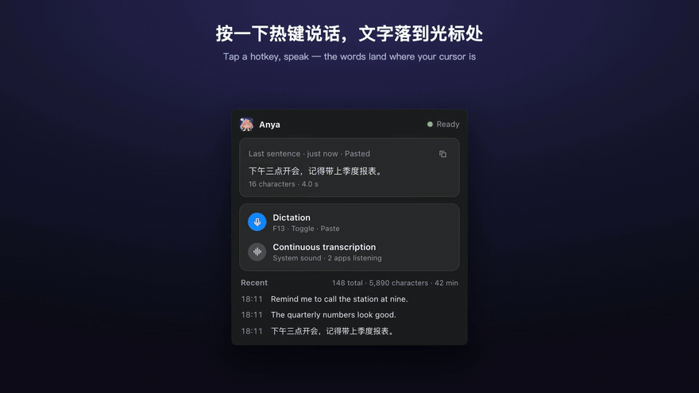
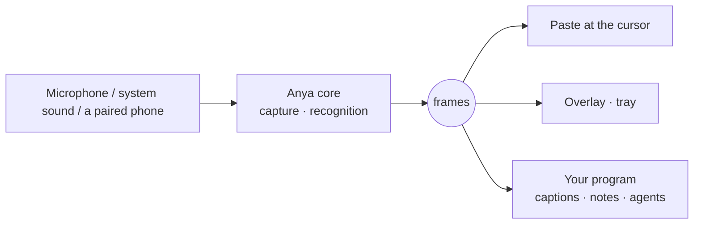
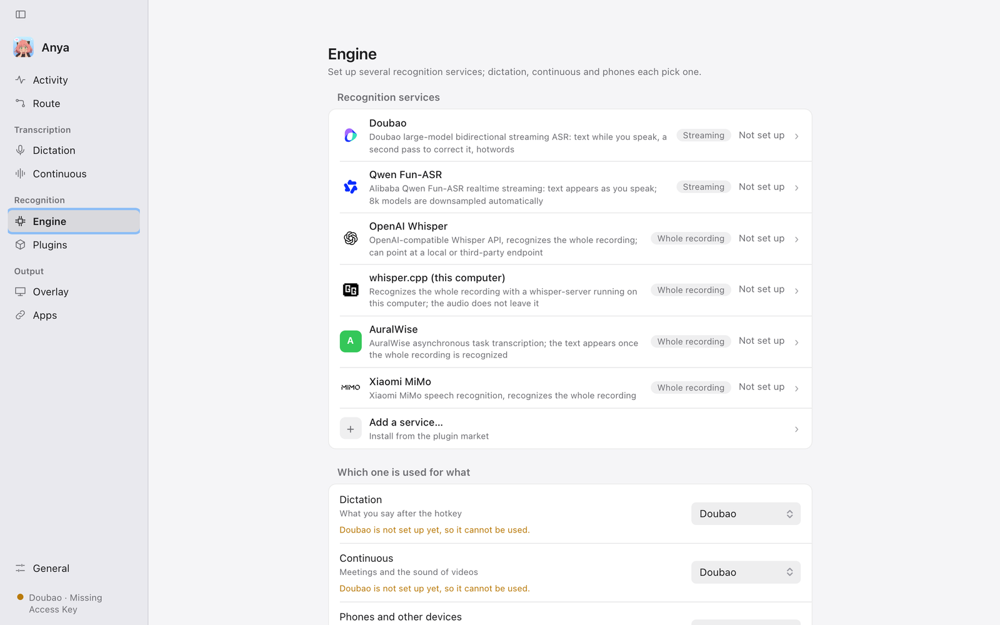
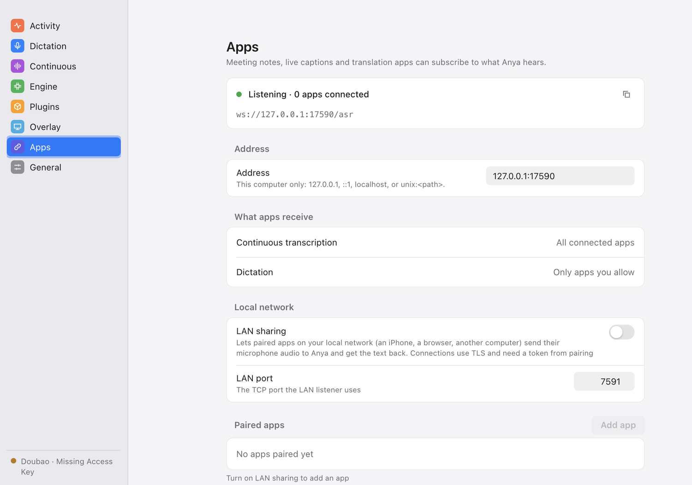
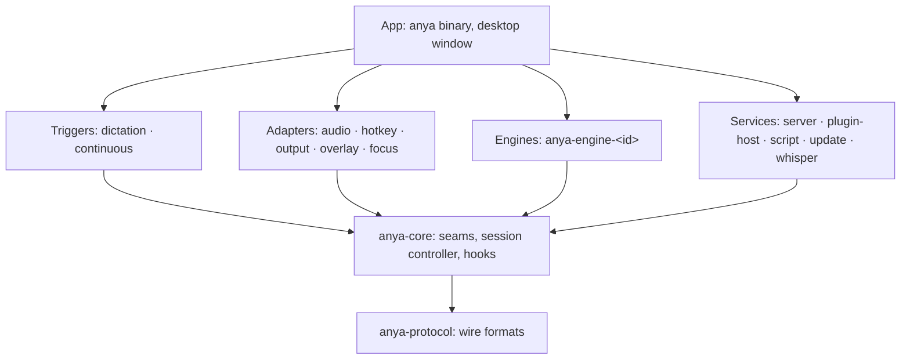

<div align="center">

<picture>
  <source media="(prefers-color-scheme: dark)" srcset="docs/assets/logo-dark.png">
  
</picture>

# Anya

**Hears what you say, and hands it to any program that wants it.**

Local speech-to-text for Linux and macOS: dictate into any field, transcribe any sound, and hand the words to programs you write.

[](https://github.com/wakaka6/anya/actions/workflows/ci.yml)
[](LICENSE)
[](rust-toolchain.toml)
[](docs/decisions/0001-rust-linux-macos.md)
[](docs/protocol.md)

[中文](README.md) · [Quick start](#quick-start) · [Protocol](docs/protocol.md) · [Plugins](docs/plugins.md) · [Architecture](ARCHITECTURE.md) · [Changelog](CHANGELOG.md)

<br>

<a href="docs/assets/demo.mp4">
  
</a>

<sub>A 54-second tour. Watch the <a href="docs/assets/demo.mp4">1080p video</a>.</sub>

</div>

## Why Anya

Most dictation tools weld hearing to one use: the text can only land in a text field. Anya splits them. A small core only captures audio and runs recognition, then publishes the result as frames. Pasting, the overlay and the tray read those frames, and your program subscribes to the very same ones.



| Feature                       | What it does                                                                                                                                        |
| ----------------------------- | --------------------------------------------------------------------------------------------------------------------------------------------------- |
| 🎙️ **Dictate into any field** | Tap a hotkey and speak; the result is pasted at the cursor or put on the clipboard.                                                                 |
| 🔊 **Transcribe any sound**   | The microphone, or what the system is playing: a CoreAudio process tap on macOS, the PulseAudio/PipeWire monitor on Linux, no virtual audio driver. |
| 🧠 **Your choice of engine**  | Six built in, cloud or on this computer; dictation, continuous transcription and LAN apps can each use a different one.                             |
| 🧩 **Plugins**                | Add engines, add hotwords per app, rewrite text before the paste, send it elsewhere at the same time.                                               |
| 📱 **An ASR gateway**         | A phone, a browser or another computer pairs by QR code and dictates with its own microphone, no engine account needed.                             |
| 🛠️ **Build on it**            | Meeting notes, live captions, translation, an agent that listens: open a WebSocket and read, no SDK.                                                |
| 🔒 **Private by default**     | Audio goes only to the engine you chose; if it fails you see the error, and Anya never quietly retries on another one.                              |

## Status

Early: version 0.1. It runs end to end on macOS and Linux (Wayland, X11), but the subscriber protocol is still version 0 and may change; every change is in the [CHANGELOG](CHANGELOG.md). Trying it, issues and pull requests are welcome.

## Quick start

Install with Homebrew (macOS, Linux):

```bash
brew install wakaka6/tap/anya
anya --doctor    # check the environment: what is missing and how to fix it
anya             # start the tray app and open the settings
```

When a new version is out, the tray panel and the settings page say so; press Upgrade or run `brew upgrade anya`.

### Linux

On Linux, Anya's window and tray use the system's WebKitGTK, GTK and AppIndicator, and pasting needs a clipboard tool; install them with your distribution's package manager first. Anya is built on Ubuntu 22.04 and runs on distributions with glibc 2.35 or newer.

| Distribution | Command |
| --- | --- |
| Ubuntu 24.04 and later, Debian 13 | `sudo apt install libwebkit2gtk-4.1-0 libayatana-appindicator3-1 libxdo3 libxtst6 libasound2t64 xclip wl-clipboard wtype` |
| Ubuntu 22.04, Debian 12 | `sudo apt install libwebkit2gtk-4.1-0 libayatana-appindicator3-1 libxdo3 libxtst6 libasound2 xclip wl-clipboard wtype` |
| Fedora | `sudo dnf install webkit2gtk4.1 libayatana-appindicator-gtk3 libxdo libXtst alsa-lib xclip wl-clipboard wtype` |
| Arch | `sudo pacman -S webkit2gtk-4.1 libayatana-appindicator xdotool libxtst alsa-lib xclip wl-clipboard wtype` |

- Clipboard: `xclip` on X11, `wl-clipboard` on Wayland; one desktop needs only its own.
- Paste keys: X11 needs nothing more; Wayland uses `wtype`, except on KDE Plasma, where `wtype` does not work and Anya needs write access to `/dev/uinput` (`anya --doctor` prints the commands).
- Global hotkeys on Wayland read `/dev/input`: run `sudo usermod -aG input $USER`, then log out and back in.

Then run `anya --doctor`; it lists anything still missing.

Or build from source, with Rust 1.95 (picked by `rust-toolchain.toml`). On Linux, install the development packages too; on Debian or Ubuntu, `sudo apt install pkg-config clang libasound2-dev libx11-dev libxcb1-dev libxkbcommon-dev libxtst-dev libwayland-dev libgtk-3-dev libwebkit2gtk-4.1-dev libayatana-appindicator3-dev libxdo-dev`:

```bash
git clone https://github.com/wakaka6/anya.git && cd anya
cargo build --release -p anya
target/release/anya --doctor    # check the environment: what is missing and how to fix it
target/release/anya --install   # copy to ~/.local/bin/anya
anya                            # start the tray app and open the settings
```

Then:

1. On the **Engine** page, pick an engine and enter its credentials. To keep the audio on this computer, pick **whisper.cpp** and let Anya download a model and run it (see [Recognition on this computer](#recognition-on-this-computer-whispercpp)).
2. In any text field, tap the hotkey, speak, and tap it again. The default is <kbd>⌥</kbd> <kbd>⌘</kbd> on macOS and <kbd>Alt</kbd> <kbd>Super</kbd> on Linux; change it, or switch to hold-to-talk, on the **Dictation** page.
3. The words land at the cursor. The **Activity** and **Route** pages show where each one came from and went.

On macOS, dictation needs the microphone and Accessibility (for pasting) permissions; `anya --doctor` lists whatever is missing and how to fix it.

## Engines

| Engine         | Recognizes                                                   | Audio goes to                                              |
| -------------- | ------------------------------------------------------------ | ---------------------------------------------------------- |
| Doubao         | Streaming: text while you speak, a second pass to correct it | Volcengine                                                 |
| Qwen Fun-ASR   | Streaming                                                    | Alibaba Cloud DashScope                                    |
| OpenAI Whisper | Whole recording                                              | OpenAI, or any compatible endpoint (Groq, your own server) |
| whisper.cpp    | Whole recording                                              | **Nowhere: it stays on this computer**                     |
| AuralWise      | Whole recording                                              | AuralWise                                                  |
| Xiaomi MiMo    | Whole recording                                              | Xiaomi MiMo                                                |

Plugins can add more; see [Plugins](#plugins).

## Use

```bash
anya                  # the tray app and settings window
anya --tui            # the terminal UI instead of the desktop window
anya --web            # open the settings page in a browser on 127.0.0.1
anya --daemon         # run without a UI, logging to stderr
anya subscribe        # print the running Anya's frames as NDJSON
anya replay <file>    # serve a recorded frame stream: build apps without a microphone
```

The config file is `~/.config/anya/config.toml`, saved atomically and readable only by you; an edit made outside Anya is picked up by a running Anya. The interface follows the system language, or `[ui] language` (English and Simplified Chinese for now).

### Hotwords

`[recognition] hotwords` holds fixed words, and more go in `hotwords.txt` next to the config file (by default `~/.config/anya/hotwords.txt`; one word per line, `#` for comments). Without that file, the config's words are used alone. It is read again before every session, so another program can keep it current. Continuous transcription without the silence gate is one long session: when the words change it reconnects once to take them, at most once every 30 seconds.

[`skills/anya-hotwords`](skills/anya-hotwords/SKILL.md) is a skill for your local coding agent. Run on a loop, it compares what Anya pasted with the message you then sent to the agent, finds the words you fixed by hand, and, with your current work in mind, refreshes the hotwords file into the short list of words you are most likely to say and most likely to be misheard.

```
/loop 10m /anya-hotwords ~/.config/anya/config.toml
```

## Recognition on this computer: whisper.cpp

<p align="center">
  <picture>
    <source media="(prefers-color-scheme: dark)" srcset="docs/assets/screenshot-engine-dark.png">
    
  </picture>
</p>

The built-in whisper.cpp engine recognizes on this computer, so the audio stays on it. Unfold whisper.cpp on the settings window's Engine page; "Who runs the server" has two answers:

- **I run it**: you start `whisper-server` and enter its address under "Server address" (empty is `http://127.0.0.1:8080`).
- **Anya runs it**: click a model in the list to download it; it is chosen once it is down. "My own model file" takes the path of any ggml model instead. When you dictate, Anya starts `whisper-server` on this computer, listening on `127.0.0.1` only, and stops it after 10 idle minutes, which frees the model's memory. Install `whisper-server` yourself: `brew install whisper-cpp`.

The suggested model is `large-v3-turbo-q5_0` (547 MB), or `small` on a computer with less than 8 GB of memory. A model downloads only when you click it, from Hugging Face by default or from a mirror you set under Advanced. Each model's hash is pinned in Anya and a download counts only once it matches, so a mirror needs no trust. A broken download resumes where it stopped. Models are kept under `models` in the data directory (`~/.local/share/anya/models` on Linux and macOS). The settings live in `[recognition.engines.whisper-cpp]`: `mode`, `model`, `program`, `idle_timeout_minutes`, `download_source`.

## Building on Anya

While Anya runs, continuous transcription streams as frames on the loopback address `ws://127.0.0.1:7590/asr`. No SDK: a line of shell is a live caption:

```console
$ anya subscribe | jq -r 'select(.type=="result") | .text'
Let's start
Let's start with the roadmap. Anya
Let's start with the roadmap. Anya ships in May.
Questions?
```

No microphone needed while you build: `anya replay crates/protocol/fixtures/continuous.jsonl` serves a recorded stream to subscribers at its original pace (that is where the output above came from).

The subscriber protocol, its ten ordering promises, the compatibility rule and streams to test against are in [docs/protocol.md](docs/protocol.md). The streams are in [`crates/protocol/fixtures/`](crates/protocol/fixtures/); `future.jsonl` holds what a newer Anya may add, so you can check that your program survives it.

## LAN sharing and pairing

<p align="center">
  
</p>

By default only this computer can connect to Anya (loopback). To let a phone, a browser or another computer send its own microphone for recognition, turn on "LAN sharing" under "Apps" in the settings (`[subscription] lan = true`, port `lan_port`, 7591 by default):

- On the network the connection is TLS (`wss://`) with a certificate Anya makes and keeps; an app trusts it by the certificate fingerprint it saw while pairing.
- "Add app" shows a six-digit pairing code and a QR code (the address, the code and the certificate fingerprint). The app scans it or takes the code and trades it for a token; a code works once and for two minutes.
- Each app is authorised on its own: dictation, receiving continuous transcription, seeing others' dictation. Change its scopes or remove it at any time; removing it closes its connections at once.
- An app's dictation result goes only to that app, never onto this computer. With a streaming engine the app gets partial results too, otherwise only the final one.

## Plugins

A plugin can provide four things:

| Kind          | When                     | For example                                                                                                 |
| ------------- | ------------------------ | ----------------------------------------------------------------------------------------------------------- |
| **engine**    | Recognition              | A speech service Anya does not ship                                                                         |
| **context**   | Before a dictation opens | Hotwords and a language for the app in front                                                                |
| **transform** | Before the paste         | Replacements, spoken punctuation, polishing; they run in the order you set and the rewritten text is pasted |
| **action**    | Beside the paste         | Keeping the text in your notes or a to-do list; never holds the paste up                                    |

The last three apply to your own dictation only, not to continuous transcription or LAN apps.

Plugins run in one of two ways. **Inline** plugins run in QuickJS inside Anya: they cannot reach the network or the disk, and every call is stopped at its time and memory budget. **Host** plugins run in a Bun process of their own (Bun 1.2 or newer; if none is found, installing the first such plugin downloads a pinned release and checks its SHA-256); Anya checks each process every second and ends and restarts one that has not answered for 3 seconds, without touching the others. Community plugins install from the index on this repository's `registry` branch, and every download is checked against its integrity hash.

```bash
anya plugin search [query]       # browse the registry
anya plugin install <id>[@ver]   # install; it starts disabled
anya plugin enable <id>          # loaded when Anya starts
anya plugin disable <id>
anya plugin remove <id>
anya plugin list
anya plugin builtin              # built-in pieces and their state
anya plugin builtin off <id>     # turn a built-in piece off (on turns it back on)
```

Install and enable are separate steps, on the settings window's Plugins page too, which lists what a plugin provides and what each part receives before you enable it.

> [!WARNING]
> An engine plugin receives the audio of every session opened on its engine (a LAN app's dictation included); a context plugin learns which app you are using; transform and action plugins receive everything you dictate. Host plugins run with your rights, with no sandbox, so enable only plugins you trust.

Changes made on the command line apply the next time Anya starts; enabling, disabling and removing in the settings window apply at once.

> [!TIP]
> Want to write one? The [plugin guide](docs/plugin-guide.en.md) takes you through your first plugin in 15 minutes, from writing and testing it to installing it and publishing it to the market; every field and rule is in the [plugin reference](docs/plugins.md).

Built-in engines can be turned off too, except the one you have chosen. One more built-in piece, `community-hooks`, runs every community plugin's context, transform and action hooks; turned off, none of them runs. These changes are written to `[plugins.builtin]` in the config file, and a running Anya reads them and applies them at once. The transform order, plugin settings and time budgets live in `[plugins] order`, `[plugins.settings.<id>]` and `[plugins.limits]`.

### Official plugins

The official plugins are in [`plugins/`](plugins/) and are built into Anya: the plugin market lists them, tagged “Official”, even without a network, and Install unpacks one from Anya itself with nothing downloaded. Like any plugin, an installed one runs only once you enable it. When you upgrade Anya, installed official plugins are updated with it at the next start, staying on or off as they were.

| Plugin               | Provides                    | What it does                                                                                                                                     |
| -------------------- | --------------------------- | ------------------------------------------------------------------------------------------------------------------------------------------------ |
| `spoken-punctuation` | context, transform (inline) | Say “逗号”, “句号”, “问号”, “换行”, “新段落” and the like to get the mark; the words also go to the engine as hotwords, so it mishears them less |
| `app-hotwords`       | context (inline)            | Adds the hotwords you list for the app in front: your project's names in the editor, commands in the terminal                                    |
| `daily-notes`        | action (Bun)                | Appends every dictation, with its time and app, to a Markdown note per day (`<folder>/2026-10-31.md`)                                            |

## Updates

Anya ships through a Homebrew tap and never replaces its own binary. Once a day it reads the tap's `Formula/anya.rb` and compares its `version` with the running one; when a newer one exists, the tray panel, the settings page and the terminal UI say so. An install under Homebrew gets an Upgrade button that runs `brew upgrade anya`; the new version runs after Anya is restarted. Any other install (a copied binary, `cargo install`) is only told that a new version is out.

The check is one request to the tap's host with `User-Agent: anya/<version>` and nothing else. To stop it, turn off "Check for updates" in the settings or write `[updates] check = false`. `[updates] formula` points the check at another formula (`https://` or `file://`).

## Architecture



Dependencies point down only, and never sideways; the rule is code (`xtask/src/arch.rs`) and `cargo test` checks it. The full picture is in [ARCHITECTURE.md](ARCHITECTURE.md); every decision and its reasons are in [docs/decisions](docs/decisions/).

## Contributing

Needs Rust 1.95, [cargo-deny](https://github.com/EmbarkStudios/cargo-deny) and Bun 1.2 or newer (for the tests in `plugins/`).

```bash
cargo xtask ci       # the full gate CI runs: fmt, clippy, tests (with the layer rules), cargo-deny, plugin tests
cargo xtask check    # layer rules only
cargo test --workspace
cargo run -p anya-gui --example web   # the settings page on fake data: no microphone or engine needed
```

Before you start, read:

- [AGENTS.md](AGENTS.md): the rules the build enforces and the ones review checks.
- [ARCHITECTURE.md](ARCHITECTURE.md): before adding a crate, a dependency between crates, or a type that crosses a seam.
- [docs/protocol.md](docs/protocol.md): before touching anything a subscriber receives. A frame change updates the types, the pins in the tests, the fixtures, the protocol doc and the CHANGELOG in one commit.
- [docs/decisions](docs/decisions/): to change a decision, write a new record that supersedes it.

Every string a user sees comes from `anya-i18n`, in every locale; user-facing text is product text. Commit subjects are `<scope>: <what changed>`, the scope a crate or area (`protocol`, `core`, `xtask`, `docs`).

## Acknowledgements

- Engine logos come from [@lobehub/icons](https://github.com/lobehub/lobe-icons) (MIT); whisper.cpp's is the [ggml-org](https://github.com/ggml-org) avatar. Each mark belongs to its owner.
- Recognition on this computer runs on [whisper.cpp](https://github.com/ggml-org/whisper.cpp); inline plugins run in [QuickJS](https://bellard.org/quickjs/), host plugins in [Bun](https://bun.sh).

## Licence

[MIT](LICENSE);
