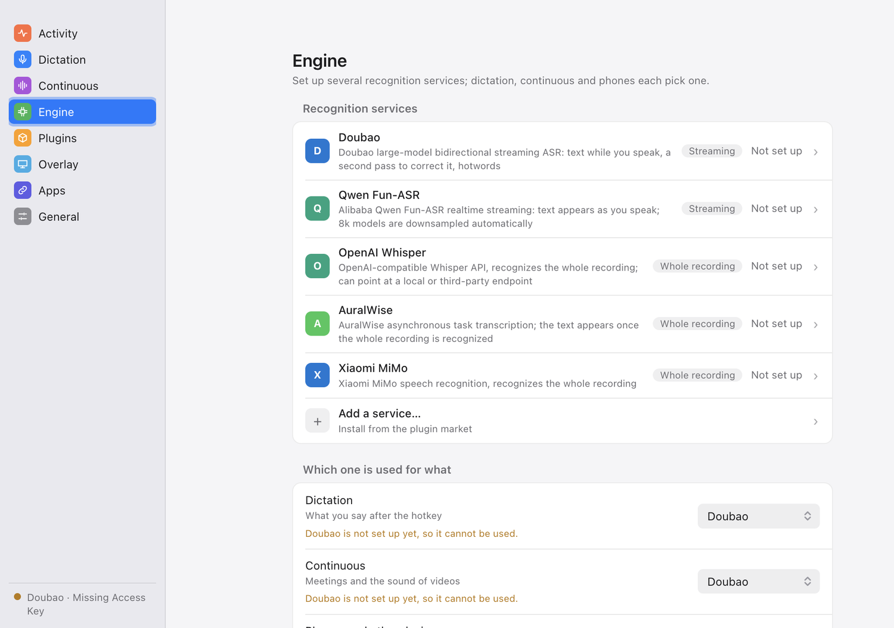
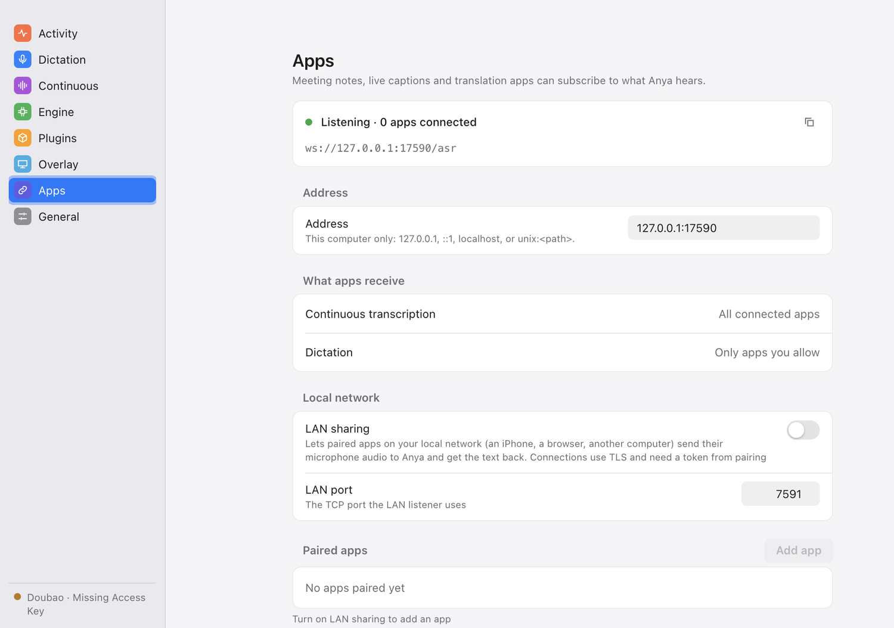
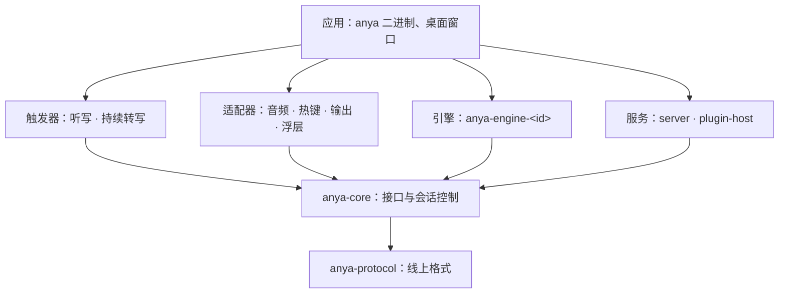

<div align="center">

<picture>
  <source media="(prefers-color-scheme: dark)" srcset="docs/assets/logo-dark.png">
  
</picture>

# Anya

**听见你说的话，交给任何想要它的程序。**

[](https://github.com/wakaka6/anya/actions/workflows/ci.yml)
[](LICENSE)
[](rust-toolchain.toml)
[](docs/decisions/0001-rust-linux-macos.md)

[English](README.en.md) · [协议](docs/protocol.md) · [插件](docs/plugins.md) · [架构](ARCHITECTURE.md) · [更新日志](CHANGELOG.md)

</div>

<p align="center">
  
</p>

Anya 是 Linux 和 macOS 上的本地语音转文字服务。一个小核心只负责录音和识别，听写、持续转写、上屏、浮层和识别引擎都插在它周围；别的程序订阅的，是内置功能读的同一套识别帧。

- **听写到任意输入框**：按住或按一下热键说话，识别结果粘贴到当前焦点，或放进剪贴板。
- **转写任意声音**：持续转写麦克风，或系统正在播放的声音（macOS 用 CoreAudio process tap，Linux 用 PulseAudio/PipeWire monitor，不需要虚拟声卡）。
- **多家引擎，自己选**：内置豆包、DashScope、OpenAI 兼容接口、AuralWise、MiMo；听写、持续转写和局域网应用可以各用各的。
- **插件扩展引擎**：社区引擎写成 npm 包，在一个 Bun 进程里运行，安装前校验完整性哈希。
- **识别网关**：手机、浏览器或另一台电脑配对后，把自己的麦克风送来识别，不需要自己的引擎账号。
- **在它上面做应用**：会议纪要、实时字幕、翻译、会听的 agent，都从同一套帧里读。
- **隐私默认值**：音频只发给你选的那一家引擎；它出错时你会看到错误，Anya 不会悄悄换另一家重试。

## 状态

早期，还没有发布版本。端到端能在 macOS 和 Linux（Wayland、X11）上跑起来，但订阅协议仍是 version 0，可能随时变化，变化都记在 [CHANGELOG.md](CHANGELOG.md)。

## 安装

目前只能从源码构建。需要 Rust 1.95（`rust-toolchain.toml` 会自动选上）。

```bash
cargo build --release -p anya
target/release/anya --doctor    # 检查运行环境，缺什么、怎么补
target/release/anya --install   # 复制到 ~/.local/bin/anya
```

## 使用

```bash
anya                  # 启动：托盘应用和设置窗口
anya --tui            # 用终端界面代替桌面窗口
anya --web            # 在 127.0.0.1 上用浏览器打开设置页
anya --daemon         # 不带界面运行，日志输出到 stderr
anya subscribe        # 以 NDJSON 输出正在运行的 Anya 的识别帧
anya replay <文件>    # 把录好的帧流回放给订阅者，开发应用时不需要麦克风
```

配置文件是 `~/.config/anya/config.toml`，保存是原子的，只有你自己可读；在 Anya 之外改它，运行中的 Anya 也会读取。界面语言跟随系统，也可以在 `[ui] language` 里指定（目前有英文和简体中文）。

### 热词

`[recognition] hotwords` 放固定的词，`hotwords_file` 指向另一个文件（一行一个词，`#` 开头是注释）。每次识别前都会重新读，所以别的程序可以随时维护它。

[`skills/anya-hotwords`](skills/anya-hotwords/SKILL.md) 是一个给本地 coding agent 用的技能：在循环里运行它，它会对照 Anya 粘贴出去的听写和你随后发给 agent 的那条消息，找出你手改过的词，再结合当前的工作，把热词文件刷新成最可能说出口、又最容易听错的那一小撮词。

```
/loop 10m /anya-hotwords ~/.config/anya/config.toml
```

## 局域网共享与配对

<p align="center">
  
</p>

默认只有这台电脑能连 Anya（回环地址）。想让手机、浏览器或别的电脑把自己的麦克风送来识别，在设置的“应用接入”里打开“局域网共享”（配置 `[subscription] lan = true`，端口 `lan_port`，默认 7591）：

- 局域网上走 TLS（`wss://`），证书由 Anya 自己生成并保存；应用靠配对时看到的证书指纹信任它。
- 点“添加应用”，设置里会出现六位配对码和二维码（内容是地址、配对码、证书指纹）。应用扫码或输入配对码，换到一个令牌；配对码两分钟内有效、只能用一次。
- 每个应用单独授权：听写、接收持续转写、查看他人的听写。随时可以改权限或移除，移除后它的连接立刻断开。
- 应用的听写结果只回给它自己，不会输入到这台电脑上。引擎支持流式时应用能收到中间结果，否则只收到最终结果。

## 在 Anya 上做应用

订阅协议、十条顺序承诺、兼容规则和测试用的样例流都在 [docs/protocol.md](docs/protocol.md)。连上回环地址的 WebSocket 就能收到持续转写，不需要 SDK。样例流在 [`crates/protocol/fixtures/`](crates/protocol/fixtures/)，其中 `future.jsonl` 是新版本可能多出来的内容，用它检查你的程序不会因此出错。

## 插件

识别引擎可以做成插件，由同一个 Bun 进程运行（要求 Bun 1.2 或更新；第一次安装插件时找不到会自动下载固定版本，并校验 SHA-256）。插件从 anyahq-plugins 仓库安装，下载内容会校验完整性哈希。

```bash
anya plugin search [关键字]      # 浏览仓库
anya plugin install <id>[@版本]  # 安装，安装后处于停用状态
anya plugin enable <id>          # 启用；Anya 启动时加载
anya plugin disable <id>
anya plugin remove <id>
anya plugin list
anya plugin builtin              # 内置引擎及其状态
anya plugin builtin off <id>     # 关闭内置引擎（on 重新开启）
```

安装和启用是两步，设置窗口的“引擎”页里也一样。**启用后的引擎插件会收到凭它的引擎开的每一次识别的音频（局域网应用的听写也算），并以你的权限运行，没有沙箱，请只启用你信得过的插件。** 命令行改动在 Anya 下次启动时生效；设置窗口里的启用、停用和移除立即生效。开发插件见 [docs/plugins.md](docs/plugins.md)。

内置引擎也可以关闭，当前选用的引擎除外；这类改动写入配置文件的 `[plugins.builtin]`，运行中的 Anya 会读取并立即生效。

## 更新

Anya 通过 Homebrew tap 分发，不会自己替换自己的程序。它每天读一次 tap 里的 `Formula/anya.rb`，看有没有比当前更新的版本；有的话，托盘面板、设置页和终端界面会提示。通过 Homebrew 安装的，提示里有“升级”按钮，运行 `brew upgrade anya`；升级完成后重启 Anya 才用上新版本。其他方式安装的（复制的程序、`cargo install`）只会被告知有新版本。

检查时只向 tap 所在的服务器发一个请求，带的只有 `User-Agent: anya/<版本>`，没有别的内容。不想让 Anya 发这个请求，在设置里关掉“检查更新”，或在配置里写 `[updates] check = false`。`[updates] formula` 可以改成别处的 formula（`https://` 或 `file://`）。

## 架构



依赖只能向下，同层之间不能互相依赖；这条规则写成了代码（`xtask/src/arch.rs`），`cargo test` 会检查。完整说明见 [ARCHITECTURE.md](ARCHITECTURE.md)，每个决定和理由见 [docs/decisions](docs/decisions/)。

## 参与开发

需要 Rust 1.95 和 [cargo-deny](https://github.com/EmbarkStudios/cargo-deny)。

```bash
cargo xtask ci       # CI 跑的完整检查：fmt、clippy、测试（含分层规则）、cargo-deny
cargo xtask check    # 只查分层规则
cargo test --workspace
```

动手之前请先读：

- [AGENTS.md](AGENTS.md)：构建强制执行的规则，和评审时会看的规则。
- [ARCHITECTURE.md](ARCHITECTURE.md)：新增 crate、crate 之间的依赖，或跨越接口的类型之前。
- [docs/protocol.md](docs/protocol.md)：改动订阅者收到的任何东西之前。帧一变，类型、测试里的固定样例、样例流、协议文档和 CHANGELOG 要在同一个提交里一起改。
- [docs/decisions](docs/decisions/)：改动某个决定之前，先写一条新的记录取代它。

用户能看到的字符串都放在 `anya-i18n`，每种语言都要有；面向用户的文字按产品文案来写。提交信息写成 `<范围>: <改了什么>`，范围是 crate 或领域（`protocol`、`core`、`xtask`、`docs`）。

## 许可证

[MIT](LICENSE)，见[决策 0006](docs/decisions/0006-mit-licence.md)。提交的贡献按同一许可证接受；并入外部代码要求其许可证与 MIT 兼容，或原作者同意。

## 更新日志

见 [CHANGELOG.md](CHANGELOG.md)。
