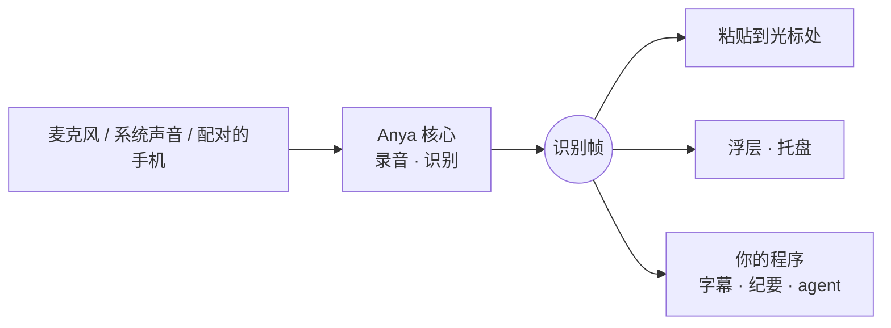
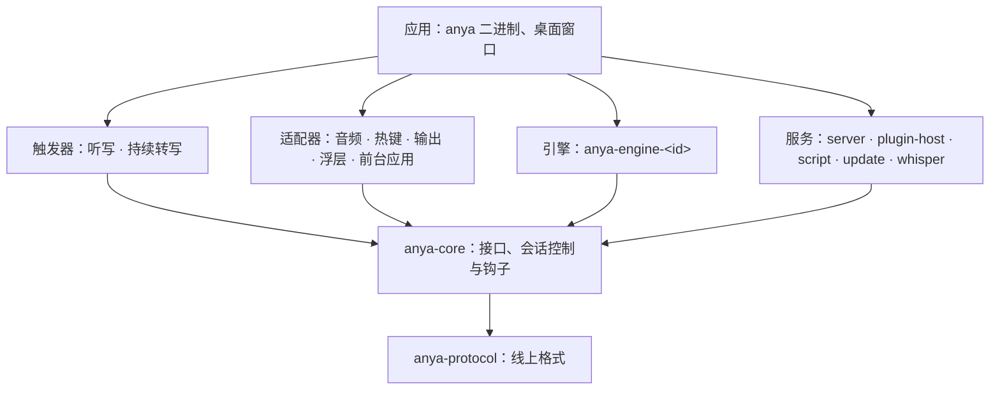

<div align="center">

<picture>
  <source media="(prefers-color-scheme: dark)" srcset="docs/assets/logo-dark.png">
  
</picture>

# Anya

**听见你说的话，交给任何想要它的程序。**

Linux 和 macOS 上的本地语音转文字服务：听写到任意输入框，转写任意声音，再把识别结果交给你写的程序。

[](https://github.com/wakaka6/anya/actions/workflows/ci.yml)
[](LICENSE)
[](rust-toolchain.toml)
[](docs/decisions/0001-rust-linux-macos.md)
[](docs/protocol.md)

[English](README.en.md) · [快速开始](#快速开始) · [协议](docs/protocol.md) · [插件](docs/plugins.md) · [架构](ARCHITECTURE.md) · [更新日志](CHANGELOG.md)

<br>

<a href="docs/assets/demo.mp4">
  
</a>

<sub>54 秒演示，点击观看 <a href="docs/assets/demo.mp4">1080p 视频</a></sub>

</div>

## 为什么是 Anya

大多数听写工具把“听”和“用”焊在一起：识别结果只能落进输入框。Anya 把它们拆开。一个小核心只负责录音和识别，然后把结果发成一套帧；上屏、浮层、托盘读的是这套帧，你的程序订阅的也是同一套。



| 能力                    | 说明                                                                                                                 |
| ----------------------- | -------------------------------------------------------------------------------------------------------------------- |
| 🎙️ **听写到任意输入框** | 按一下热键说话，结果粘贴到当前焦点，或放进剪贴板。                                                                   |
| 🔊 **转写任意声音**     | 麦克风，或系统正在播放的声音：macOS 用 CoreAudio process tap，Linux 用 PulseAudio/PipeWire monitor，不需要虚拟声卡。 |
| 🧠 **引擎自己选**       | 六个内置引擎，云端或本机；听写、持续转写和局域网应用可以各用各的。                                                   |
| 🧩 **插件**             | 提供新引擎、按应用补热词、粘贴前改写文字、把文字同时送去别处。                                                       |
| 📱 **识别网关**         | 手机、浏览器或另一台电脑扫码配对，用自己的麦克风识别，不需要引擎账号。                                               |
| 🛠️ **在它上面做应用**   | 会议纪要、实时字幕、翻译、会听的 agent：连上 WebSocket 就能读，不需要 SDK。                                          |
| 🔒 **隐私默认值**       | 音频只发给你选的那一家引擎；它出错你会看到，Anya 不会悄悄换一家重试。                                                |

## 状态

早期版本（0.1）。端到端能在 macOS 和 Linux（Wayland、X11）上跑起来，但订阅协议仍是 version 0，可能变化，每次变化都记在 [CHANGELOG.md](CHANGELOG.md)。欢迎试用、提 issue 和 PR。

## 快速开始

用 Homebrew 安装（macOS、Linux）：

```bash
brew install wakaka6/tap/anya
anya --doctor    # 检查运行环境：缺什么、怎么补
anya             # 启动托盘应用，打开设置窗口
```

想让 Anya 在后台运行、登录后自动启动（macOS）：

```bash
brew services start anya     # 现在启动，以后每次登录自动启动
brew services stop anya      # 停止，并取消自动启动
```

托盘里点“退出”只结束这一次，下次登录照常启动；Anya 崩溃时会自动重新拉起。日志在 `$(brew --prefix)/var/log/anya.log`。

以后有新版本时，托盘面板和设置页会提示，点“升级”或运行 `brew upgrade anya` 即可；用 `brew services` 运行的，升级后运行 `brew services restart anya` 换上新版本。

### Linux

Linux 版的窗口和托盘用系统自带的 WebKitGTK、GTK 和 AppIndicator，粘贴要用剪贴板工具，这些要先用系统的包管理器装好。程序在 Ubuntu 22.04 上构建，支持 glibc 2.35 及更新的发行版。

| 发行版 | 命令 |
| --- | --- |
| Ubuntu 24.04 及更新、Debian 13 | `sudo apt install libwebkit2gtk-4.1-0 libayatana-appindicator3-1 libxdo3 libxtst6 libasound2t64 xclip wl-clipboard wtype` |
| Ubuntu 22.04、Debian 12 | `sudo apt install libwebkit2gtk-4.1-0 libayatana-appindicator3-1 libxdo3 libxtst6 libasound2 xclip wl-clipboard wtype` |
| Fedora | `sudo dnf install webkit2gtk4.1 libayatana-appindicator-gtk3 libxdo libXtst alsa-lib xclip wl-clipboard wtype` |
| Arch | `sudo pacman -S webkit2gtk-4.1 libayatana-appindicator xdotool libxtst alsa-lib xclip wl-clipboard wtype` |

- 剪贴板：X11 用 `xclip`，Wayland 用 `wl-clipboard`，只用其中一种桌面的话装对应的那个即可。
- 粘贴按键：X11 不需要别的东西；Wayland 用 `wtype`，KDE Plasma 上 `wtype` 不可用，需要 `/dev/uinput` 的写权限，`anya --doctor` 会给出具体命令。
- Wayland 上的全局热键要读 `/dev/input`：运行 `sudo usermod -aG input $USER`，然后注销并重新登录。

装好后运行 `anya --doctor`，还缺什么会逐项列出。

登录后自动启动：Linux 桌面用 XDG autostart，不用 `brew services`。

```bash
mkdir -p ~/.config/autostart
cat > ~/.config/autostart/anya.desktop <<EOF
[Desktop Entry]
Type=Application
Name=Anya
Exec=$(brew --prefix)/bin/anya
EOF
```

也可以从源码构建，需要 Rust 1.95（`rust-toolchain.toml` 会自动选上）。Linux 上还要装开发包，Debian、Ubuntu 上是 `sudo apt install pkg-config clang libasound2-dev libx11-dev libxcb1-dev libxkbcommon-dev libxtst-dev libwayland-dev libgtk-3-dev libwebkit2gtk-4.1-dev libayatana-appindicator3-dev libxdo-dev`：

```bash
git clone https://github.com/wakaka6/anya.git && cd anya
cargo build --release -p anya
target/release/anya --doctor    # 检查运行环境：缺什么、怎么补
target/release/anya --install   # 复制到 ~/.local/bin/anya
anya                            # 启动托盘应用，打开设置窗口
```

然后：

1. 在设置的 **引擎** 页选一个引擎填上凭据；不想让音频离开电脑，就选 **whisper.cpp**，让 Anya 下载模型、自己运行它（见[在本机识别](#在本机识别whispercpp)）。
2. 在任意输入框里按一下热键开始说话，再按一下结束。默认热键 macOS 是 <kbd>⌥</kbd> <kbd>⌘</kbd>，Linux 是 <kbd>Alt</kbd> <kbd>Super</kbd>，可以在 **听写** 页改，也能改成按住说话。
3. 文字落到光标处。**活动** 页和 **路由** 页里能看到每一句从哪来、去了哪。

macOS 上听写需要麦克风和辅助功能（用来粘贴）权限；缺了什么、怎么补，`anya --doctor` 会逐项告诉你。

## 引擎

| 引擎           | 识别方式                     | 音频去向                                 |
| -------------- | ---------------------------- | ---------------------------------------- |
| 豆包语音       | 流式：边说边出字，第二遍校正 | 火山引擎                                 |
| 千问 Fun-ASR   | 流式                         | 阿里云 DashScope                         |
| OpenAI Whisper | 整段                         | OpenAI，或任何兼容接口（Groq、自建服务） |
| whisper.cpp    | 整段                         | **不离开这台电脑**                       |
| AuralWise      | 整段                         | AuralWise                                |
| 小米 MiMo      | 整段                         | 小米 MiMo                                |

插件可以再加引擎，见[插件](#插件)。

## 使用

```bash
anya                  # 托盘应用和设置窗口
anya --tui            # 用终端界面代替桌面窗口
anya --web            # 在 127.0.0.1 上用浏览器打开设置页
anya --daemon         # 不带界面运行，日志输出到 stderr
anya subscribe        # 以 NDJSON 输出正在运行的 Anya 的识别帧
anya replay <文件>    # 把录好的帧流回放给订阅者，开发应用时不需要麦克风
```

配置文件是 `~/.config/anya/config.toml`，保存是原子的，只有你自己可读；在 Anya 之外改它，运行中的 Anya 也会读取。界面语言跟随系统，也可以在 `[ui] language` 里指定（目前有英文和简体中文）。

### 热词

`[recognition] hotwords` 放固定的词，更多的词写进配置文件旁边的 `hotwords.txt`（默认 `~/.config/anya/hotwords.txt`，一行一个词，`#` 开头是注释）。没有这个文件就只用配置里的词。每次识别前都会重新读，所以别的程序可以随时维护它。持续转写不开静音门时只有一个长会话，词变了它会重连一次来用上新词，两次重连至少隔 30 秒。

[`skills/anya-hotwords`](skills/anya-hotwords/SKILL.md) 是一个给本地 coding agent 用的技能：在循环里运行它，它会对照 Anya 粘贴出去的听写和你随后发给 agent 的那条消息，找出你手改过的词，再结合当前的工作，把热词文件刷新成最可能说出口、又最容易听错的那一小撮词。

用 [`npx skills`](https://github.com/vercel-labs/skills) 安装，它会把技能装进你正在用的 coding agent：

```
npx skills add wakaka6/anya --skill anya-hotwords
```

装好后在循环里运行：

```
/loop 10m /anya-hotwords ~/.config/anya/config.toml
```

## 在本机识别：whisper.cpp

<p align="center">
  <picture>
    <source media="(prefers-color-scheme: dark)" srcset="docs/assets/screenshot-engine-dark.png">
    
  </picture>
</p>

内置引擎 whisper.cpp 在这台电脑上识别，音频不离开它。在设置的“引擎”页展开 whisper.cpp，“运行方式”有两种：

- **我自己运行**：你启动 `whisper-server`，在“服务地址”里填它的地址（留空为 `http://127.0.0.1:8080`）。
- **由 Anya 启动**：在模型列表里点一个模型下载，下好后自动选中；也可以选“自己的模型文件”填一个 ggml 模型的路径。听写时 Anya 在本机启动 `whisper-server`，只监听 `127.0.0.1`，空闲 10 分钟后退出，退出后释放模型占的内存。`whisper-server` 本身要自己装：`brew install whisper-cpp`。

推荐的模型是 `large-v3-turbo-q5_0`（547 MB），内存少于 8 GB 的电脑推荐 `small`。模型只在你点下载时才下载，默认从 Hugging Face，“高级”里可以换成镜像；每个模型的哈希写死在 Anya 里，下载完校验通过才算下好，所以镜像不需要被信任。下载中断后从断开的地方接着下。模型存放在数据目录的 `models` 下（Linux 和 macOS 都是 `~/.local/share/anya/models`）。配置写在 `[recognition.engines.whisper-cpp]`：`mode`、`model`、`program`、`idle_timeout_minutes`、`download_source`。

## 在 Anya 上做应用

Anya 运行时，回环地址 `ws://127.0.0.1:7590/asr` 上就有持续转写的帧流。不需要 SDK，几行 shell 就是一个实时字幕：

```console
$ anya subscribe | jq -r 'select(.type=="result") | .text'
Let's start
Let's start with the roadmap. Anya
Let's start with the roadmap. Anya ships in May.
Questions?
```

开发时不需要麦克风：`anya replay crates/protocol/fixtures/continuous.jsonl` 把录好的帧流按原节奏回放给订阅者（上面的输出就是这样得到的）。

订阅协议、十条顺序承诺、兼容规则和测试用的样例流都在 [docs/protocol.md](docs/protocol.md)。样例流在 [`crates/protocol/fixtures/`](crates/protocol/fixtures/)，其中 `future.jsonl` 是新版本可能多出来的内容，用它检查你的程序不会因此出错。

## 局域网共享与配对

<p align="center">
  
</p>

默认只有这台电脑能连 Anya（回环地址）。想让手机、浏览器或别的电脑把自己的麦克风送来识别，在设置的“应用接入”里打开“局域网共享”（配置 `[subscription] lan = true`，端口 `lan_port`，默认 7591）：

- 局域网上走 TLS（`wss://`），证书由 Anya 自己生成并保存；应用靠配对时看到的证书指纹信任它。
- 点“添加应用”，设置里会出现六位配对码和二维码（内容是地址、配对码、证书指纹）。应用扫码或输入配对码，换到一个令牌；配对码两分钟内有效、只能用一次。
- 每个应用单独授权：听写、接收持续转写、查看他人的听写。随时可以改权限或移除，移除后它的连接立刻断开。
- 应用的听写结果只回给它自己，不会输入到这台电脑上。引擎支持流式时应用能收到中间结果，否则只收到最终结果。

## 插件

插件可以提供四样东西：

| 类型          | 时机       | 例子                                                               |
| ------------- | ---------- | ------------------------------------------------------------------ |
| **engine**    | 识别       | 接入一家新的语音识别服务                                           |
| **context**   | 听写开始前 | 按前台应用补充热词和语言                                           |
| **transform** | 粘贴前     | 替换词、口述标点、润色；按你排的顺序依次执行，粘贴的是改写后的文字 |
| **action**    | 和粘贴同时 | 记进笔记、整理待办；不会拖慢粘贴                                   |

后三样只作用于你自己的听写，不作用于持续转写和局域网应用。

插件有两种运行方式。**inline** 在 Anya 内部的 QuickJS 里运行，不能联网也不能读写文件，每次调用有时间和内存上限，超时会被直接打断。**host** 在插件自己的 Bun 进程里运行（要求 Bun 1.2 或更新；第一次安装这类插件时找不到会自动下载固定版本，并校验 SHA-256），Anya 每秒检查一次，3 秒没有回应就结束并重启这个进程，不影响其他插件。社区插件从本仓库 `registry` 分支上的索引安装，下载内容会校验完整性哈希。

```bash
anya plugin search [关键字]      # 浏览仓库
anya plugin install <id>[@版本]  # 安装，安装后处于停用状态
anya plugin enable <id>          # 启用；Anya 启动时加载
anya plugin disable <id>
anya plugin remove <id>
anya plugin list
anya plugin builtin              # 内置部件及其状态
anya plugin builtin off <id>     # 关闭内置部件（on 重新开启）
```

安装和启用是两步，设置窗口的“插件”页里也一样，启用前会列出插件提供什么、各自会拿到什么。

> [!WARNING]
> 引擎插件会收到凭它的引擎开的每一次识别的音频（局域网应用的听写也算）；context 插件会知道当前在用哪个应用；transform 和 action 插件会收到你听写的全部文字。host 插件以你的权限运行，没有沙箱，请只启用你信得过的插件。

命令行改动在 Anya 下次启动时生效；设置窗口里的启用、停用和移除立即生效。

> [!TIP]
> 想写一个？[插件开发指南](docs/plugin-guide.md)带你 15 分钟写出、测试并装上第一个插件，再发布到插件市场；完整的字段和约定见[插件参考](docs/plugins.md)。

内置引擎也可以关闭，当前选用的引擎除外。另一个内置部件 `community-hooks` 运行所有社区插件的 context、transform 和 action，关掉它这些都不再执行。这类改动写入配置文件的 `[plugins.builtin]`，运行中的 Anya 会读取并立即生效。改写的顺序、插件设置和时间上限分别在 `[plugins] order`、`[plugins.settings.<id>]` 和 `[plugins.limits]`。

### 官方插件

官方插件在 [`plugins/`](plugins/)，随 Anya 一起编进程序：插件市场不联网也会列出它们，标着“官方”，点“安装”直接从 Anya 里解包，不用下载。装好后同样要启用才会运行。升级 Anya 后，已装的官方插件会在启动时一起更新，开关状态保持不变。

| 插件                 | 提供                         | 做什么                                                                               |
| -------------------- | ---------------------------- | ------------------------------------------------------------------------------------ |
| `spoken-punctuation` | context、transform（inline） | 听写时说“逗号”“句号”“问号”“换行”“新段落”等得到标点；这些词也作为热词交给引擎，少听错 |
| `app-hotwords`       | context（inline）            | 按前台应用加上你为它列的热词，比如编辑器里用项目名，终端里用命令名                   |
| `daily-notes`        | action（Bun）                | 把每次听写连同时间和应用，追加到当天的 Markdown 笔记（`<文件夹>/2026-10-31.md`）     |

## 更新

Anya 通过 Homebrew tap 分发，不会自己替换自己的程序。它每天读一次 tap 里的 `Formula/anya.rb`，看有没有比当前更新的版本；有的话，托盘面板、设置页和终端界面会提示。通过 Homebrew 安装的，提示里有“升级”按钮，运行 `brew upgrade anya`；升级完成后重启 Anya 才用上新版本。其他方式安装的（复制的程序、`cargo install`）只会被告知有新版本。

检查时只向 tap 所在的服务器发一个请求，带的只有 `User-Agent: anya/<版本>`，没有别的内容。不想让 Anya 发这个请求，在设置里关掉“检查更新”，或在配置里写 `[updates] check = false`。`[updates] formula` 可以改成别处的 formula（`https://` 或 `file://`）。

## 架构



依赖只能向下，同层之间不能互相依赖；这条规则写成了代码（`xtask/src/arch.rs`），`cargo test` 会检查。完整说明见 [ARCHITECTURE.md](ARCHITECTURE.md)，每个决定和理由见 [docs/decisions](docs/decisions/)。

## 参与开发

需要 Rust 1.95、[cargo-deny](https://github.com/EmbarkStudios/cargo-deny) 和 Bun 1.2 或更新（跑 `plugins/` 的测试）。

```bash
cargo xtask ci       # CI 跑的完整检查：fmt、clippy、测试（含分层规则）、cargo-deny、插件测试
cargo xtask check    # 只查分层规则
cargo test --workspace
cargo run -p anya-gui --example web   # 不需要麦克风和引擎，用假数据试设置页
```

动手之前请先读：

- [AGENTS.md](AGENTS.md)：构建强制执行的规则，和评审时会看的规则。
- [ARCHITECTURE.md](ARCHITECTURE.md)：新增 crate、crate 之间的依赖，或跨越接口的类型之前。
- [docs/protocol.md](docs/protocol.md)：改动订阅者收到的任何东西之前。帧一变，类型、测试里的固定样例、样例流、协议文档和 CHANGELOG 要在同一个提交里一起改。
- [docs/decisions](docs/decisions/)：改动某个决定之前，先写一条新的记录取代它。

用户能看到的字符串都放在 `anya-i18n`，每种语言都要有；面向用户的文字按产品文案来写。提交信息写成 `<范围>: <改了什么>`，范围是 crate 或领域（`protocol`、`core`、`xtask`、`docs`）。

## 致谢

- 引擎 logo 来自 [@lobehub/icons](https://github.com/lobehub/lobe-icons)（MIT），whisper.cpp 的图标是 [ggml-org](https://github.com/ggml-org) 的头像；各标志归其所有者。
- 本机识别靠 [whisper.cpp](https://github.com/ggml-org/whisper.cpp)，inline 插件跑在 [QuickJS](https://bellard.org/quickjs/) 里，host 插件跑在 [Bun](https://bun.sh) 里。

## 许可证

[MIT](LICENSE)
